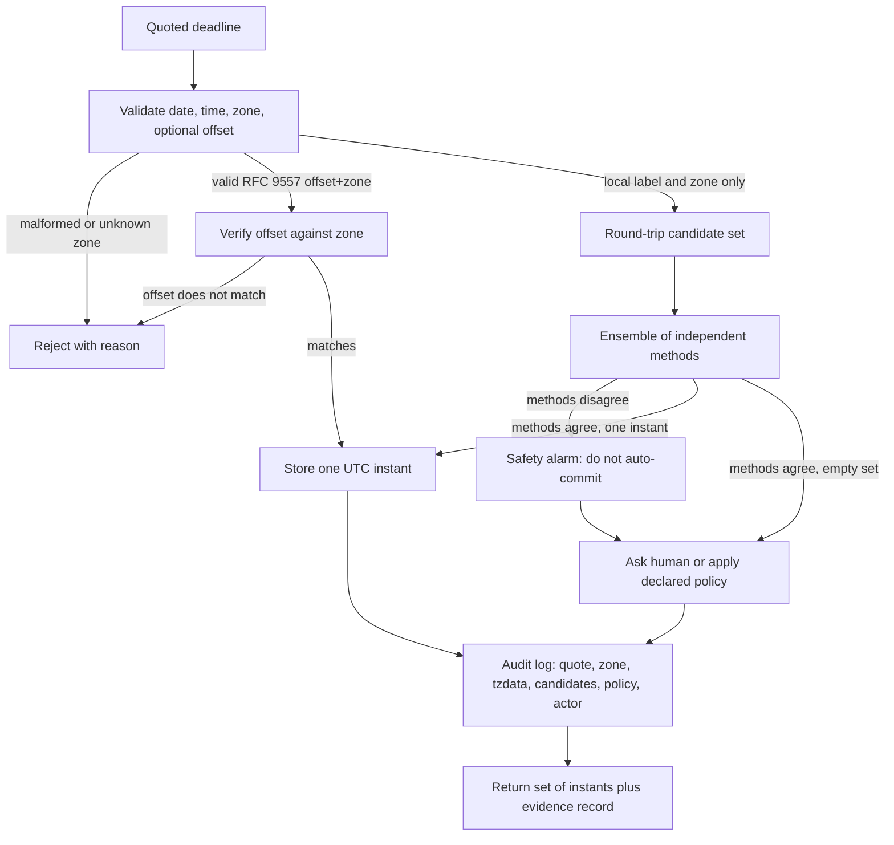

# A deadline-resolution service (post-sprint sketch)

Added 19 November 2026. This is a design note, not a deployed system, and it is not part of the judged sprint report. It shows how the strategies in this folder could sit behind a small service that turns a quoted local deadline into an auditable set of instants.

## Goal

Accept a civil-time deadline as a human stated it (a local date, a time, and a named zone, optionally with an offset), and return exactly the set of UTC instants that statement supports. If the statement is incomplete or contradictory, refuse to invent an instant, ask for a confirmation or a policy choice, and keep a record of what was decided.

The paper already supplies the core contract: the output is a *set*, which may have zero, one, or two instants. This sketch adds input checks, an explicit policy, a disagreement alarm, and an audit log.

## Components

1. **Input validation.** Parse the quoted text into a naive local date-time, an IANA zone id, and, if present, an RFC 9557 / ISO 8601 offset. Reject unknown zones, malformed timestamps, and impossible calendar dates before any conversion. If an offset is present, parse it with the zone (`rfc9557.parse_rfc9557`) and reject an offset that the zone does not actually use at that instant.

2. **Canonicalisation.** If the source already carries a valid offset and zone, treat that as decisive: store the UTC instant, the original string, the zone, the offset, and the tzdata version. No policy is required. If only a local label and a zone are present, continue to the resolver.

3. **Resolver.** Compute the exact set with the paper's round-trip method (`clock_evidence.possible`). Classify the label as unique, gap, or repeat.

4. **Policy engine.** For a unique label, commit the single UTC instant. For a gap or a repeat, do not guess. Apply a caller-declared policy (reject; ask a human; or, if the caller has opted in, earliest / latest for repeats and shift-forward for gaps, as in RFC 5545-style invalid-time handling and `java.time.ZonedDateTime.ofLocal` / `ofStrict`). The policy name is stored with the result. The default for a scheduling assistant should be reject-or-confirm, not a silent earliest/latest pick.

5. **Ensemble alarm.** Independently run the round-trip set, Python's default fold, earliest-with-reject, latest-with-reject, and fail-closed. If those methods do not all return the same instant set, raise a safety alarm and refuse to auto-commit. On the paper grid this alarm catches every gap and repeat and is silent on every unique label (see `RESULTS.md`).

6. **Audit log.** Append-only record of the original quote, the parsed fields, the tzdata version, the computed candidate instants, the policy applied, whether a human confirmed it, the ensemble verdict, and a hash of the previous log entry. This is the paper's "evidence record" as a service log, not a new empirical finding.

## Request flow

## What this does not do

It does not parse natural-language notices, infer a zone from a city abbreviation, or measure how often real assistants make this mistake. It uses the same time-zone database for the oracle and the converters, so it cannot detect an outdated legal rule. Those limits are already stated in the judged report and still apply here.
